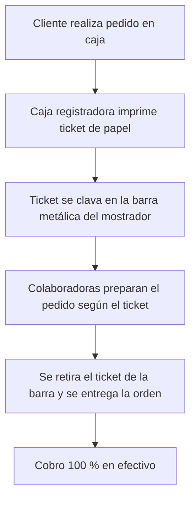

# Evidencias de Recolección de Información

A continuación se presentan las entrevistas realizadas como parte del levantamiento de requerimientos y del análisis del contexto operativo de los comercios locales evaluados.

## Índice

- [Entrevista 1: Refacciones Las Delicias](#entrevista-1-refacciones-las-delicias)
- [Entrevista 2: Refacciones Anlu](#entrevista-2-refacciones-anlu)
- [Análisis de Flujo de Negocio y Contexto Operativo](#análisis-de-flujo-de-negocio-y-contexto-operativo)

---

## Entrevista 1: Refacciones Las Delicias

### Ficha del negocio

| Campo | Detalle |
| --- | --- |
| **Entrevistada** | Alicis Rojas |
| **Puesto / Rol** | Propietaria y Encargada de Operaciones |
| **Giro del negocio** | Venta de comida rápida y refacciones de fin de semana (hamburguesas, papas, frappes, smoothies, pasteles, nachos, cappuccinos y bebidas) |
| **Días de atención** | Exclusivamente domingos, de 3:00 PM a 10:00 PM |
| **Personal** | 4 colaboradoras fijas + 2 propietarios en caja |
| **Trayectoria** | 21 años de servicio |

### Grabación de audio

<iframe src="https://drive.google.com/file/d/1_qOM9MJdWU5AYJlhr7WA44DsVuSdzcs3/preview" width="100%" height="80" allow="autoplay" style="border-radius: 8px; border: 1px solid #ccc; margin-bottom: 1.5rem;"></iframe>

### Resumen operativo y puntos de dolor identificados

1. **Picos de saturación:** la mayor afluencia de clientes ocurre de 6:00 PM a 8:00 PM, momento en el que el flujo de pedidos se concentra de forma intensiva.
2. **Gestión de comandas:** utilizan una caja registradora para imprimir comprobantes y los organizan en una barra metálica física. Ocasionalmente ocurren retrasos o entregas incorrectas debido al retiro accidental o prematuro de los tickets.
3. **Modalidad de pago:** operan 100 % en efectivo. Han considerado incorporar pago con tarjeta de crédito/débito, pero temen que el proceso ralentice la atención en el mostrador.
4. **Planificación de insumos:** realizan compras semanales y mensuales en la capital para mantener el stock. La demanda de productos como frappes y smoothies varía según las condiciones climáticas del fin de semana.

---

## Entrevista 2: Refacciones Anlu

### Ficha del negocio

| Campo | Detalle |
| --- | --- |
| **Entrevistada** | Ana Lucía López |
| **Puesto / Rol** | Propietaria y Encargada Única |
| **Giro del negocio** | Venta de refacciones y desayunos rápidos en entorno universitario |
| **Horario de atención** | Lunes a viernes, de 6:00 AM a 10:00 AM |
| **Personal** | 1 persona (atendido únicamente por la propietaria) |

### Grabación de audio

<iframe src="https://drive.google.com/file/d/1m4ZXPaa-QN2-CIpQhRdbVBB2nM1N-dA-/preview" width="100%" height="80" allow="autoplay" style="border-radius: 8px; border: 1px solid #ccc; margin-bottom: 1.5rem;"></iframe>

### Resumen operativo y puntos de dolor identificados

1. **Horario crítico y alta presión:** el momento de mayor demanda ocurre entre las 7:00 AM y las 8:30 AM, cuando debe atender de forma individual a clientes que van con el tiempo justo hacia sus labores o clases.
2. **Operación unipersonal:** al no contar con asistentes, la propietaria debe encargarse simultáneamente de tomar pedidos, preparar alimentos, cobrar y despachar, confiando principalmente en su memoria y organización mental.
3. **Manejo de stock y sustituciones:** realiza compras al por mayor 3 veces por semana y recibe pan diariamente. A pesar de calcular las proporciones, es común que se agote algún ingrediente en horas pico, por lo que debe improvisar o sustituir insumos de forma ágil.
4. **Arqueo diario:** al finalizar la jornada (10:00 AM), efectúa un cuadre manual del inventario residual contra los ingresos de caja en efectivo.
5. **Barrera tecnológica:** intentó utilizar herramientas digitales en el pasado, pero las descartó porque siente que operar pantallas o aplicaciones en el mostrador le resta segundos valiosos durante la atención al cliente.

---

# Análisis de Flujo de Negocio y Contexto Operativo

El presente análisis evalúa la dinámica operativa, la estructura de trabajo y las restricciones técnicas de **Refacciones Las Delicias**, con el fin de diseñar soluciones tecnológicas adaptadas a su entorno real.

## Comercio evaluado: Refacciones Las Delicias

### Descripción general

Negocio familiar con 21 años de trayectoria, enfocado en la preparación y venta de comida rápida (hamburguesas, papas, frappes, smoothies, pasteles, nachos y bebidas) durante jornadas dominicales.

| Aspecto | Detalle |
| --- | --- |
| **Horario de operación** | Exclusivamente domingos, de 3:00 PM a 10:00 PM |
| **Estructura del equipo** | 6 personas: 2 encargados en caja y administración + 4 colaboradoras en preparación y despacho |
| **Flujo de atención** | Picos intensivos de demanda entre las 6:00 PM y las 8:00 PM |

### Diagrama del flujo operativo actual

### Desafíos y puntos de dolor identificados

1. **Saturación en horas pico:** entre las 6:00 PM y las 8:00 PM, la acumulación masiva de pedidos genera confusión en el orden de llegada.
2. **Manejo físico de tickets:** ocurre traspapelo o retiro accidental de comandas impresas antes de ser despachadas, lo que deriva en retrasos o platillos entregados por error.
3. **Limitación en medios de pago:** la preferencia por el cobro en efectivo responde al temor de ralentizar la atención en caja por la manipulación de terminales bancarias o claves.
4. **Insumos estacionales:** la demanda de productos helados (frappes y smoothies) varía drásticamente según las condiciones climáticas del fin de semana.
