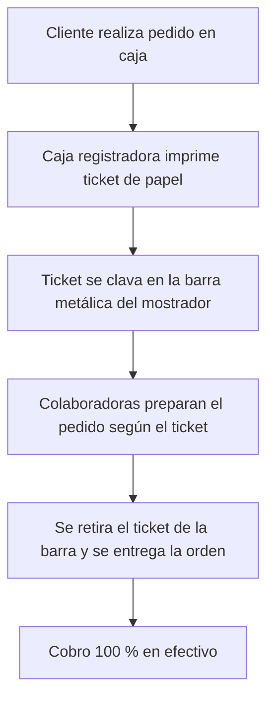

### Diagrama del flujo operativo actual
 

 
### Desafíos y puntos de dolor identificados
 
1. **Saturación en horas pico:** entre las 6:00 PM y las 8:00 PM, la acumulación masiva de pedidos genera confusión en el orden de llegada.
2. **Manejo físico de tickets:** ocurre traspapelo o retiro accidental de comandas impresas antes de ser despachadas, lo que deriva en retrasos o platillos entregados por error.
3. **Limitación en medios de pago:** la preferencia por el cobro en efectivo responde al temor de ralentizar la atención en caja por la manipulación de terminales bancarias o claves.
4. **Insumos estacionales:** la demanda de productos helados (frappes y smoothies) varía drásticamente según las condiciones climáticas del fin de semana.
 
