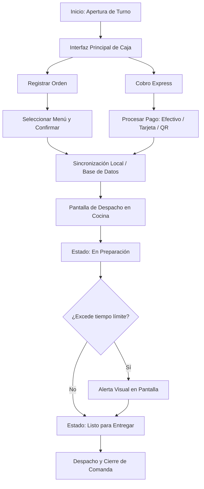
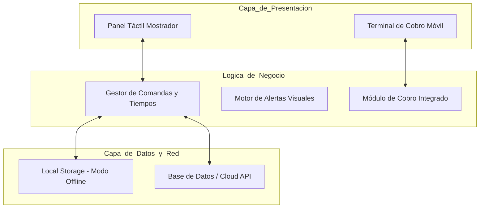

# Flujo de la Solución Propuesta y Arquitectura de Prototipo

---

## Diagrama de Flujo del Sistema Web / Aplicación Local

El siguiente flujo representa el funcionamiento del sistema propuesto para optimizar la operación.

## Arquitectura General de Componentes

## Especificaciones del Prototipo de Interfaz (UI/UX)

### 1. Tablero de Comandas en Mostrador

- **Diseño visual:** Modo oscuro de alto contraste (Dark Mode) para reducir la fatiga visual.
- **Distribución de pantalla:**
  - **Columna Izquierda (Pendientes):** Tarjetas de color azul que muestran el número de orden.
  - **Columna Central (En Preparación):** Tarjetas que cambian a color amarillo si superan los 5 minutos.
  - **Columna Derecha (Listos para Despacho):** Tarjetas verdes con botón grande de confirmación.

### 2. Módulo de Cobro Express

- **Distribución:** Botones de gran tamaño (mínimo 48px × 48px) con iconografía clara para cada producto.
- **Flujo de selección:**
  1. Selección de producto.
  2. Selección de método de pago (Efectivo / QR / Tarjeta).
  3. Confirmación automática.
